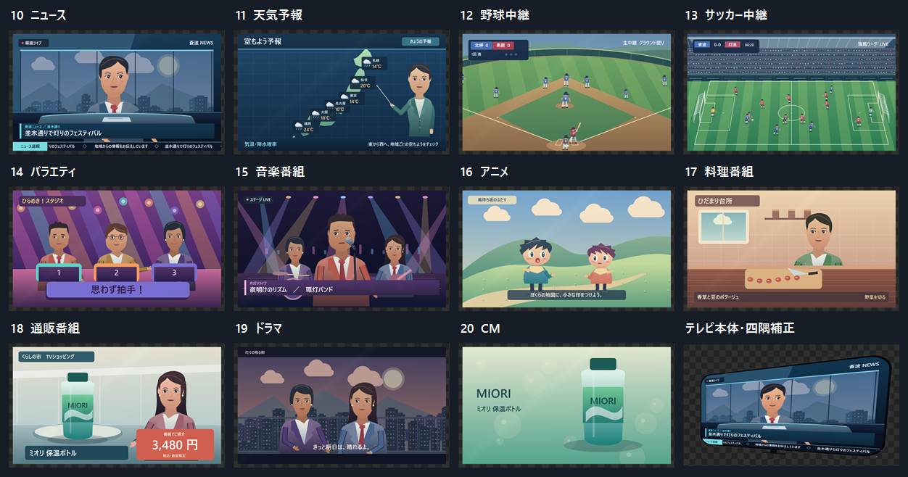

# テレビ演出（SYNC_TV）

AviUtl ExEdit2 のテレビ画面に、ニュース・天気予報・スポーツ中継など11種類の架空の番組を表示する Win64 プラグインです。動画素材の準備は不要です。チャンネル切替、液晶の反射、消灯時の画面も再現します。

## 動作環境

- AviUtl ExEdit2 2.1.16 以降（Win64）
- 配布バージョンは **v1.0.0**
- 映像を出力します。音声は生成しません。

## インストールとアンインストール

| 操作 | 手順 |
| --- | --- |
| インストール | AviUtl2を終了し、`SYNC_TV.zip` を展開します。展開した `SYNC_TV` フォルダーを丸ごと `C:\ProgramData\aviutl2\Plugin` にコピーします。 |
| アンインストール | AviUtl2を終了し、`C:\ProgramData\aviutl2\Plugin\SYNC_TV` フォルダーを丸ごと削除します。 |

既定のパスを使わない場合は、ご利用の AviUtl2 のプラグインフォルダーを指定します。AviUtl2カタログでも、選んだパッケージの `SYNC_TV` フォルダー単位でインストール・アンインストールします。

## 使い方

1. タイムラインのメディアオブジェクト追加メニューで **SYNC → テレビ演出** を選びます。追加直後はチャンネル10のニュースが表示されます。
2. テレビ画面が透明な背景画像では、このオブジェクトを背景画像の背面に置きます。背景画像に重ねる場合は、`縦横比`、`角丸`、`四隅補正` で画面枠に合わせます。
3. `テレビ本体描画` をオンにすると、ベゼル、スタンド、電源インジケーターを表示します。`周囲の明るさ` は0が暗い部屋、100が明るい部屋です。

既定の画面は960×540ピクセルです。画面形状の `縦横比` は −43.750 で16:9、0で正方形になります。位置・拡大率・透明度・回転は AviUtl2 の **標準描画** で調整します。遠近付きのX軸・Y軸回転は **カメラ制御** を使います。`四隅補正` は各角をピクセル単位で移動します。

チャンネルの中間点を `瞬間移動` にすると、黒画面を挟む切替や電源のオン・オフを演出できます。連続補間では、通過する整数チャンネルごとに切り替わります。

## チャンネル

| 番号 | 映像 | 番号 | 映像 |
| ---: | --- | ---: | --- |
| 0 | 電源OFF | 12 | 野球中継 |
| 1 | 砂嵐 | 13 | サッカー中継 |
| 2 | カラーバー | 14 | バラエティ番組 |
| 3 | 信号なし | 15 | 音楽番組 |
| 4～9 | 放送休止（予約） | 16 | アニメ番組 |
| 10 | ニュース番組 | 17 | 料理番組 |
| 11 | 天気予報 | 18 | 通販番組 |
|  |  | 19 | ドラマ |
|  |  | 20 | CM |

21以上では放送休止画面が表示されます。

## ライセンス

Copyright (c) 2026 VRAMの魔術師

本プラグインは GNU General Public License v3.0 のみ（GPL-3.0-only）で配布します。詳細は [LICENSE](LICENSE) をご覧ください。AviUtl ExEdit2 Plugin SDK 由来の型定義は MIT ライセンスです。 [第三者ライセンスと継承元](THIRD_PARTY_NOTICES.md)

配布ZIPに同梱する `SYNC_TV-source` に、このバージョンの対応ソースコードとビルドに使う Delphi プロジェクトを収録しています。
